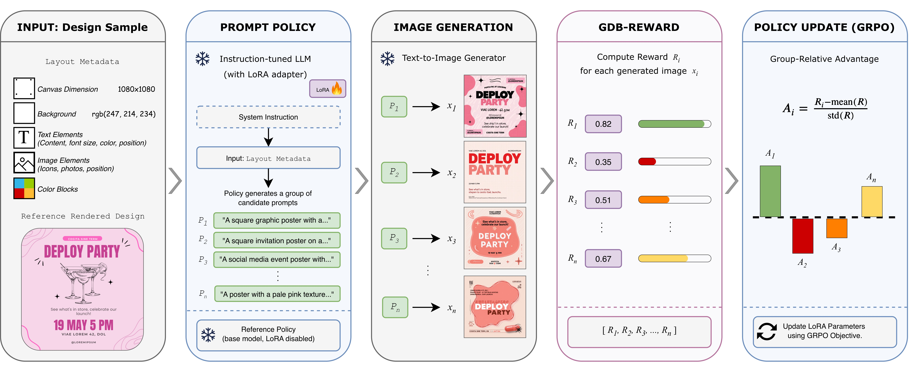

# GDB-Reward: From Evaluation Metrics to Training Rewards for Graphic Design

This repository contains the official implementation of: "GDB-Reward: From Evaluation Metrics to Training Rewards for Graphic Design" [[arXiv]](https://arxiv.org/pdf/2609.02813)

## Overview

